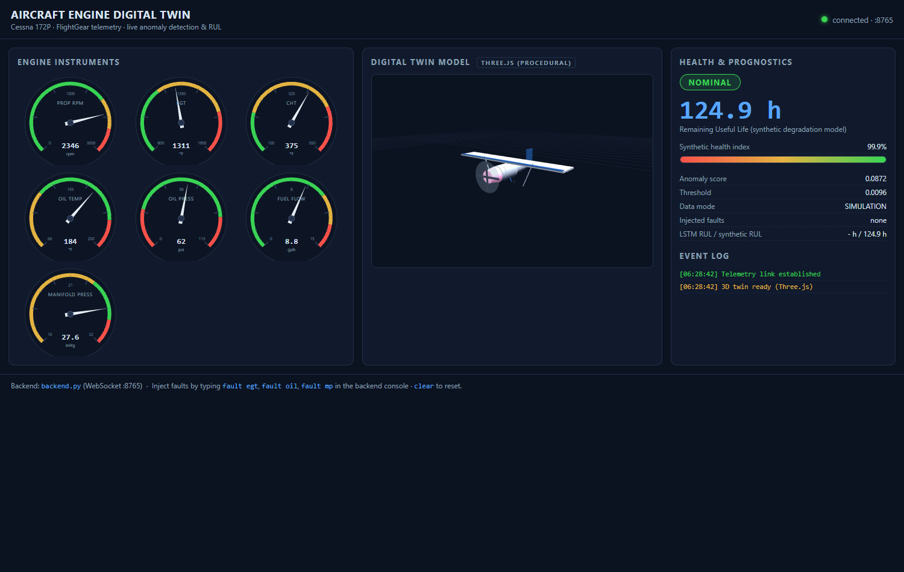
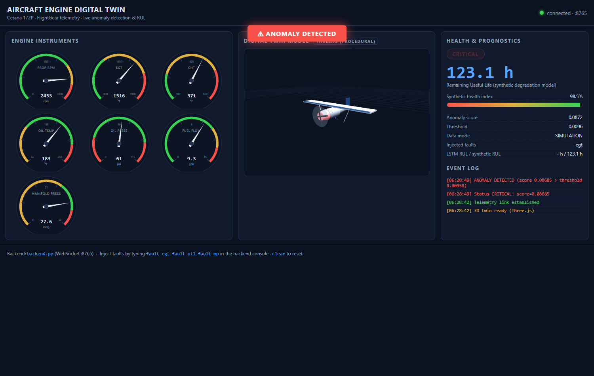

# Aircraft Engine Digital Twin (FlightGear + ML + Web)

A fully local, open-source digital twin of a Cessna 172P piston engine:

* **Data source:** FlightGear flight simulator (telnet property interface)
* **Analytics:** autoencoder anomaly detection + LSTM Remaining-Useful-Life
  model, trained on the NASA C-MAPSS FD001 dataset (`train_models.py`)
* **Serving:** `backend.py` — polls sensors at 1 Hz, runs inference, and
  broadcasts JSON over a WebSocket on port 8765
* **Dashboard:** `index.html` + `dashboard.js` — custom SVG gauges, a Three.js
  low-poly Cessna whose propeller spins with RPM and whose engine cowling
  glows blue→red with EGT, plus anomaly alarms and an event log

---

## 1. Architecture

> Live captures (headless Chromium, simulation mode) — see `docs/`:
>
> | Nominal | Anomaly injected (`fault egt`) |
> |---|---|
> |  |  |


```
+--------------------------------------------------------------+
|                     FlightGear Simulator                      |
|  Cessna 172P, engine model writes the property tree           |
|    --telnet=5500   (property read/write)                      |
|    --httpd=8080    (optional web property browser)            |
+---------------------------+----------------------------------+
                            | telnet: get/set properties (1 Hz)
+---------------------------v----------------------------------+
|                    backend.py  (Python)                       |
|                                                               |
|  TelnetClient --> sensor snapshot (7 params)                  |
|        |                                                      |
|        +--> min-max normalization                             |
|        |            |                                        |
|        |     +------+---------------------------------+      |
|        |     v                                       v      |
|        |  Autoencoder (.h5)                    LSTM RUL (.h5) |
|        |  reconstruction MSE -> score          window -> RUL  |
|        |     |                                       |      |
|        |  threshold compare             synthetic degradation|
|        |     |                              health index h   |
|        |     +-------------> fused JSON snapshot <--+      |
|        |                               (sensors, status,   |
|        |                                anomaly, RUL)      |
|  FaultManager <-- console commands: fault egt / oil / mp       |
+---------------------------+----------------------------------+
                            | WebSocket ws://localhost:8765
+---------------------------v----------------------------------+
|              index.html + dashboard.js (browser)              |
|  * SVG gauges (RPM/EGT/CHT/oil/fuel-flow/MP)                  |
|  * Three.js Cessna: prop speed = RPM,                         |
|    cowling emissive = EGT, red flash on anomaly               |
|    (falls back to procedural 3D, then to 2D SVG)              |
+---------------------------------------------------------------+
```

## 2. Project files

| File | Purpose |
|---|---|
| `backend.py` | Telemetry poller + ML inference + WebSocket server |
| `train_models.py` | Trains AE & LSTM on NASA C-MAPSS FD001 → `models/*.h5` (`--eval-only` scores the official test set) |
| `selftest.py` | 20 regression tests for backend logic (`python selftest.py`) |
| `run_demo.ps1` | One-command launcher (backend + web server + dashboard) |
| `index.html` / `dashboard.js` | Browser dashboard |
| `data/` | NASA C-MAPSS FD001 files (already included, see below) |
| `models/` | Created by training; loaded by backend |
| `requirements.txt` | Python dependencies |

## 3. Setup

```powershell
# 1. Install dependencies (Python 3.9-3.12 recommended)
pip install -r requirements.txt

# 2. Train models on the included real FD001 data
python train_models.py            # add --demo to use synthetic data instead

# Other subsets (files included; artifacts go to a separate dir so the
# deployed models/ used by the digital twin are never clobbered):
python train_models.py --subset FD003 --out-dir models_FD003
python train_models.py --subset FD002 --out-dir models_FD002
python train_models.py --eval-only --out-dir models_FD003   # re-score anytime
# FD002/FD004 mix six operating regimes -> training k-means-clusters the
# op-settings and trains on the dominant (cruise-equivalent) regime; the
# test-set evaluation applies the same regime filter via scaler.json.
```

### Launch FlightGear (Cessna 172P, telnet + http interfaces)

Windows (adjust path to your install):

```bat
"C:\Program Files\FlightGear 2020.3\bin\fgfs.exe" ^
  --aircraft=c172p --airport=KSFO ^
  --telnet=5500 --httpd=8080
```

Linux/macOS:

```bash
fgfs --aircraft=c172p --airport=KSFO --telnet=5500 --httpd=8080
```

If you normally start via the Qt launcher, enable *Telnet (5500)* and
*HTTP interface* under Settings → Network instead.

### Monitored engine properties (C172P)

| Property | Meaning | Typical cruise |
|---|---|---|
| `/engines/engine[0]/rpm` | propeller RPM | ~2300–2500 |
| `/engines/engine[0]/egt-degf` | exhaust gas temp °F | ~1200–1400 |
| `/engines/engine[0]/cht-degf` | cylinder head temp °F | ~350–420 |
| `/engines/engine[0]/oil-temperature-degf` | oil temp °F | ~180–200 |
| `/engines/engine[0]/oil-pressure-psi` | oil pressure psi | ~55–70 |
| `/engines/engine[0]/fuel-flow-gph` | fuel flow gph | ~8–10 |
| `/engines/engine[0]/mp-osi` | manifold pressure inHg | ~26–28 |

(`backend.py` probes both `/engines/engine[0]` and `/engines/engine`
prefixes automatically.)

## 4. Run everything

**One command (Windows):**

```powershell
.\run_demo.ps1                # simulation mode, opens the dashboard
.\run_demo.ps1 -FlightGear    # use live FlightGear telnet on :5500
```

**Manual steps:**

```powershell
# Terminal 1 - simulator (command above), then:
# Terminal 2:
python backend.py
# Terminal 3 (optional, nicer than file://):
python -m http.server 8000
```

Open <http://localhost:8000/index.html> (or double-click `index.html`).
The header dot turns green when telemetry streams.

**Backend console commands** (typed into the backend terminal):

| Command | Effect |
|---|---|
| `start` / `stop` | cheat-start / stop the engine (sets mixture, throttle, running) |
| `fault egt` | EGT ramps toward 1850 °F → hot-section anomaly |
| `fault oil` | oil pressure decays toward 10 psi → oil-leak anomaly |
| `fault mp` | manifold pressure decays → power-loss anomaly |
| `fault oiltemp` | oil temperature ramps toward 250 °F → overheat anomaly |
| `fault cht` | CHT ramps toward 530 °F → cylinder-overheat anomaly |
| `fault ff` | fuel flow collapses toward 2 gph → starvation anomaly |
| `fault mixture` | pulls the REAL mixture lever toward 0.30 — FlightGear physics produces the EGT soar / power fade (emulated in simulation mode) |
| `clear` | remove injected faults |
| `heal` | reset synthetic health to 100 % and re-calibrate detector |
| `status`, `help`, `quit` | info |

No FlightGear installed? `python backend.py --simulation` runs the whole
pipeline against a built-in simulated engine — ideal for testing the
dashboard and models first.

## 5. Simulating faults (three ways)

1. **Backend console** (easiest): type `fault egt` — watch the score rise,
   banner flash, engine glow red, RUL/health drop.
2. **FlightGear property browser:** menu *Debug → Browse Internal
   Properties*, navigate to `/engines/engine[0]/oil-pressure-psi`,
   right-click → *Assign value* (e.g. `15`). Values written this way are
   re-written by the sim each frame; the backend's fault injector keeps
   forcing values every second, which is why method 1 is steadier.
3. **Manual telnet** (PowerShell):

```powershell
$c = New-Object System.Net.Sockets.TcpClient("localhost",5500)
$s = $c.GetStream(); $b = New-Object System.Text.ASCIIEncoding
$s.Write($b.GetBytes("set /engines/engine[0]/egt-degf 1750`n"),0,44)
$c.Close()
```

### Resetting for continued testing

Type `clear` then `heal` in the backend console (clears overrides, restores
health/calibration). For c172p-specific failures under `/failsafe/...`,
set them back to `false` via the property browser, or simply restart
FlightGear.

## 6. Troubleshooting

| Symptom | Likely cause / fix |
|---|---|
| Backend logs "telnet not reachable" | FlightGear started without `--telnet=5500`; firewall prompt denied; FG still loading — retries continue automatically. Use `--simulation` to test without FG. |
| `mode: FLIGHTGEAR` but sensors all 0 | Engine off — type `start`, or start it manually in FG (mixture rich, throttle up, `s` to crank). |
| Dashboard dot stays grey/red | Backend not running, port blocked, or you opened the page over https. Check `python backend.py` output; ensure nothing else occupies 8765. |
| Port conflicts (5500/8080/8765 busy) | Change ports consistently: `--telnet-port` / `--ws-port` for backend; `--telnet=NNNN` for FG; edit `CFG.WS_URL` in `dashboard.js`. |
| `ModuleNotFoundError: tensorflow` | `pip install tensorflow-cpu` (or plain `tensorflow`). Backend degrades gracefully: statistical fallback detection + synthetic-only RUL. |
| TF install fails on Windows Store Python ("Windows Long Path support") | TensorFlow's deep folders overflow MAX_PATH inside the Store-Python site-packages. Either enable Win32 long paths (admin) or install to a short path:<br>`pip install --target C:\pylibs tensorflow-cpu` then `set PYTHONPATH=C:\pylibs`. Delete any `numpy*`/`pandas*` folders copied into `C:\pylibs` so your own (newer) copies win. |
| `ValueError: numpy.dtype size changed` on import | Binary ABI mismatch between numpy and an old scikit-learn/pandas. Fix: `pip install -U numpy pandas scikit-learn`. |
| `Could not deserialize 'keras.metrics.mse'` when loading `.h5` | Keras 3 + legacy HDF5 metric-name quirk. Already handled by this project (models are saved with metric objects and loaded with `compile=False`). If you bring older artifacts, retrain or load with `load_model(..., compile=False)`. |
| LSTM RUL unavailable for the first ~75 s | By design: the 30-sample window must fill, then the LSTM is offset-anchored to the synthetic health model (domain transfer) before its value is trusted. |
| LSTM RUL shows a strange absolute value | The model is trained on turbofan data; only its degradation *trend* is meaningful on FlightGear inputs. The backend anchors the absolute level to the synthetic health model after calibration (`heal` re-anchors). |
| Anomaly triggers immediately after startup | Detector calibrates during the first ~45 s of running; keep the engine near cruise during warm-up, then `heal` if needed. Single-sensor gross deviations (>8 % of range from nominal) flag immediately even during calibration. |
| Black 3D panel | WebGL disabled or CDN blocked → dashboard switches to the 2D SVG view automatically; serve locally (`python -m http.server 8000`). |
| Gauges jitter wildly | Another process writing properties, or multiple backend instances running. Close duplicates. |

## 7. Honest limitations (prototype scope)

* C-MAPSS features describe a turbofan; we map its normalized healthy
  envelope onto the 7 normalized C172P channels. This is a demonstration of
  the *methodology*, not certified engine diagnostics.
* The LSTM outputs cycles; 1 cycle ≙ 1 hour by convention here.
* Cross-domain transfer is handled by **offset anchoring**: after ~45 s of
  nominal operation the LSTM's absolute output is anchored to the synthetic
  health model, and only its degradation *trend* is trusted thereafter
  (`heal` re-anchors). Absolute RUL accuracy on a piston single is therefore
  synthetic-model accuracy, not turbofan-LSTM accuracy.
* Anomaly detection is dual-path: AE reconstruction score (trusted only
  after online calibration) OR any single sensor >8 % off its adapted
  nominal band. Hard single-sensor faults are caught immediately; slow
  multi-sensor drifts are caught once calibration settles (~45 s).
* Property overrides fight the sim's own engine model each frame; the
  backend wins because it writes immediately before each 1 Hz read.

## 8. Verification performed (Windows 11, Python 3.12, TF-CPU 2.21)

**Training on the included real NASA C-MAPSS FD001 data**
(`python train_models.py --epochs-ae 60 --epochs-lstm 80`, unit-wise
validation split — harder than the usual random split):

* Autoencoder healthy/degraded reconstruction-error separation **×6.4**
  (threshold auto-derived: mean+4σ of healthy = 0.00958)
* LSTM validation **RMSE 14.9 / MAE 10.9 h**, PHM08 score 16,235 — in line
  with published simple-LSTM FD001 baselines (~16 RMSE @ cap 125)

**Official FD001 test set** (`python train_models.py --eval-only`,
100 engines, ground truth from RUL_FD001.txt):

* LSTM **RMSE 15.97 / MAE 11.74 / PHM08 score 525**
* Autoencoder reconstruction error correlates positively with true
  degradation (r = +0.46)
* Scatter + histogram: `docs/fd001_test_evaluation.png`
  (regenerated by every `--eval-only` / training run)

**Multi-subset support** (`--subset`, artifacts in `models_FD00x/`):

| Subset | Regimes used | AE separation | Official test RMSE / MAE / PHM08 |
|---|---|---|---|
| FD001 (deployed) | 1 of 1 | ×6.4 | **15.97 / 11.74 / 525** |
| FD003 | 1 of 1 (2 fault modes) | ×11.8 | **13.42 / 10.31 / 328** |
| FD002 | 1 of 6 (dominant, k-means) | ×8.0 | **21.09 / 15.81 / 4253** (259 engines) |
| FD004 | 1 of 6 (dominant, k-means; 2 fault modes) | ×9.6 | **19.00 / 14.00 / 2294** (248 engines) |

**Live pipeline** (`backend.py --simulation` + WebSocket client):
both models load; LSTM RUL appears at ~75 s (window fill + anchoring);
`fault egt` flags an anomaly in ~4 s via the dual-path detector; health and
fused RUL decay while the fault is active.

**Browser** (headless Chromium): gauges/3D render, zero JS errors, banner +
WARNING/CRITICAL states captured in `docs/screenshot_*.png`.
